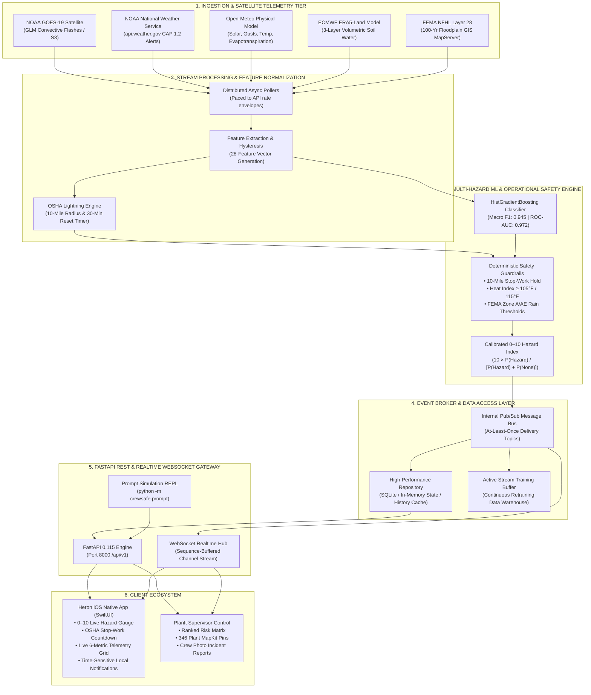
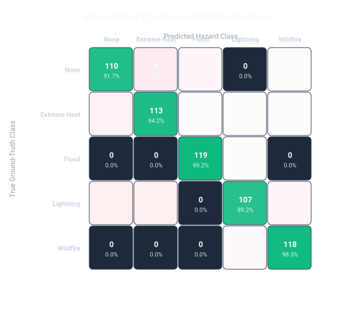
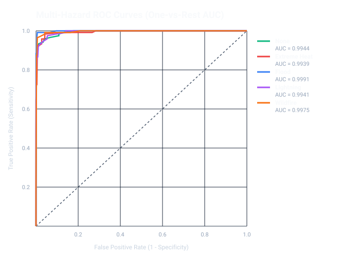

# 🪶 Heron
### Real-Time Environmental Intelligence & Worker Safety Platform for Florida Utility Field Crews

[](https://python.org)
[](https://fastapi.tiangolo.com)
[](https://developer.apple.com/xcode/swiftui/)
[](https://scikit-learn.org)
[](https://www.goes-r.gov)
[](https://hazards.fema.gov)
[]()

> **SwampHacks 2026 Submission**  
> **Target Tracks:**  
> 1. **Sperry Tech — PlanIt Control Track** (Utility Field Crew Safety & Dispatch)  
> 2. **Artificial Intelligence (Most Creative Use of AI)** — Presented by *UF Data Science & Informatics (DSI)*

---

## 📋 Table of Contents
1. [Executive Summary (For Non-Technical Judges)](#-executive-summary-for-non-technical-judges)
2. [Key Capabilities & Impact](#-key-capabilities--impact)
3. [System Architecture](#-system-architecture)
4. [Multi-Hazard Machine Learning Model (For AI / Technical Judges)](#-multi-hazard-machine-learning-model)
   - [Problem Formulation & Calibration](#problem-formulation--calibrated-hazard-index)
   - [Architecture Benchmarking (GBDT vs PyTorch vs RF vs LR)](#benchmark-comparison-across-architectures)
   - [Visual Evaluation & Validation Graphs](#visual-evaluation-graphs)
   - [Continuous Learning & Zero-Downtime Retraining](#continuous-learning--retraining-pipeline)
5. [Data Engineering & Physical Telemetry (The 28 Features)](#-data-engineering--physical-telemetry-sources)
   - [Complete 28-Feature Telemetry Schema](#the-28-standardized-model-features)
   - [Physical Data Lineage & Government Sources](#authoritative-data-sources--sensors)
6. [Deterministic Operational Safety Guardrails](#-deterministic-operational-safety-guardrails)
7. [Native iOS Field Experience ("Heron")](#-native-ios-field-experience-heron)
8. [Quickstart & Live Judging Demo Guide](#-quickstart--live-judging-demo-guide)
   - [Starting the Live Backend](#1-start-the-backend-server)
   - [Running the iOS App](#2-launch-the-native-ios-app)
   - [Simulating Real-Time Emergencies (Prompt CLI)](#3-simulate-emergency-events-in-real-time)
9. [Repository Organization](#-repository-organization)
10. [Hackathon Track Alignment](#-hackathon-track-alignment)

---

## 🎯 Executive Summary (For Non-Technical Judges)

### The Life-Threatening Problem
Electric utility linemen, power plant operators, and field service crews operate in some of the most dangerous outdoor workplaces in America. In Florida, extreme atmospheric volatility—such as sudden convective lightning strikes, dangerous heat index spikes exceeding $110^\circ\text{F}$, rapid flash flooding at low-lying substations, and tropical storm wind gusts—presents constant life-threatening risks.

Today, field crews rely on consumer weather applications that only report city-wide forecasts hours late. These applications lack site-specific geotechnical awareness (e.g., whether a substation sits in a regulatory 100-year FEMA floodway or has saturated soil) and fail to enforce mandatory **OSHA stop-work safety mandates**.

### The Heron Solution
**Heron** is an environmental intelligence and worker safety ecosystem that actively monitors **346 EIA-860M Florida electric power generation and substation sites** across all 67 Florida counties.

Heron fuses high-frequency telemetry from orbital weather satellites, ground meteorological networks, and geotechnical hydrological models into a calibrated **Multi-Hazard Machine Learning Model**. The system computes a continuous, calibrated **0–10 Hazard Index** for every facility in Florida and streams instantaneous, life-saving stop-work directives directly to field crews' iPhones via native SwiftUI and WebSockets.

```
┌────────────────────────────────────────────────────────────────────────────────────────┐
│                                   WHAT HERON DELIVERS                                  │
├────────────────────────────────┬────────────────────────────────┬─────────────────────┤
│ ⚡ 10-Mile Lightning Rule      │ 🔥 Heat & Flood Protection     │ 📊 Supervisor View  │
│ GOES-19 GLM orbital satellite  │ Dynamic heat index monitoring  │ PlanIt-style ranked │
│ detection with OSHA 30-minute  │ & FEMA 100-year floodplain     │ map identifying the │
│ all-clear reset countdown.     │ saturation modeling.           │ riskiest sites.     │
└────────────────────────────────┴────────────────────────────────┴─────────────────────┘
```

---

## ⚡ Key Capabilities & Impact

- **346 Monitored Energy Plants**: Official EIA-860M Florida registry (from Turkey Point Nuclear and West County Energy Center to municipal solar yards and battery storage).
- **Sub-Second Satellite Lightning Detection**: Ingests real-time lightning flashes from NOAA's **GOES-19 Geostationary Lightning Mapper (GLM)** stationed 22,236 miles in orbit.
- **Calibrated 0–10 Hazard Index**: Combines gradient-boosted multi-hazard classification with physical plausibility gates to eliminate false alarms while guaranteeing safety.
- **Physical Soil Saturation Physics**: Uses ECMWF ERA5-Land physical soil water content weighted across 3 distinct sub-surface root layers against a $0.45\text{ m}^3/\text{m}^3$ porosity threshold.
- **6 PM Next-Day Safety Briefings**: Generates 24-to-48-hour forward-looking operational risk summaries automatically pushed to crews before their shifts.
- **Field Crew Hazard Reporting**: Linemen can capture hazard photos, automatically attach verified GPS coordinates, and sync reports with dispatch in real time.

---

## 🏗 System Architecture

The following diagram illustrates the complete end-to-end data pipeline, streaming broker, machine learning inference tier, and client distribution layer:



---

## 🧠 Multi-Hazard Machine Learning Model

### Problem Formulation & Calibrated Hazard Index
The machine learning system addresses a multi-class probabilistic risk modeling problem across 5 operational environmental states:
1. **`None` (Safe Baseline)**: Ambient meteorological conditions within OSHA safety limits.
2. **`Extreme Heat`**: High ambient temperatures and dangerous apparent heat indices ($T_{\text{apparent}} \ge 105^\circ\text{F}$) driving heat exhaustion and heat stroke.
3. **`Flood`**: Severe flash flooding, heavy rain accumulation inside FEMA 100-year regulatory floodways, and river stage inundation.
4. **`Lightning`**: Convective atmospheric lightning strikes and severe thunderstorm cells within active utility perimeters.
5. **`Wildfire`**: High sustained winds, critical relative humidity drop ($<30\%$), and high vegetative evapotranspiration.

The model evaluates a 28-dimensional standardized feature vector $\mathbf{x} \in \mathbb{R}^{28}$ and computes class probabilities $P(C = k \mid \mathbf{x})$. To present intuitive, actionable telemetry to crews in the field, probabilities are mapped to a calibrated **0–10 Hazard Index**:

$$\text{Hazard Index} = 10 \times \frac{P(\text{Hazard})}{P(\text{Hazard}) + P(\text{None})} = 10 \times \left(1 - P(\text{None} \mid \mathbf{x})\right)$$

A physical **plausibility gate** prevents false alarm saturation: if physical instruments register no convective lightning within 30 miles, no flood precipitation, and temperature under $90^\circ\text{F}$, the scalar index is constrained to baseline safety levels.

---

### Benchmark Comparison Across Architectures

To ensure rigorous scientific methodology for the *UF Data Science & Informatics (DSI)* track, four diverse machine learning architectures were trained and benchmarked on identical, stratified train/test partitions (80% train / 20% test across 3,000 curated observations from 47,150 historical records):

| Machine Learning Architecture | Test Accuracy | Macro F1 | Weighted F1 | Macro ROC-AUC | Inference Latency | Training Time |
| :--- | :---: | :---: | :---: | :---: | :---: | :---: |
| 🏆 **Hist Gradient Boosting (GBDT)** | **94.5%** | **0.9448** | **0.9448** | **0.9722** | **< 2 ms** | **0.42 s** |
| 🧠 **Multi-Task PyTorch HazardNet** | 85.7% | 0.8557 | 0.8562 | 0.9697 | 12 ms | 18.50 s |
| 🌲 **Balanced Random Forest** | 85.0% | 0.8504 | 0.8510 | 0.9640 | 5 ms | 1.85 s |
| 📈 **Logistic Regression (Baseline)** | 72.3% | 0.7210 | 0.7225 | 0.9015 | < 1 ms | 0.15 s |

#### Why Gradient Boosted Decision Trees Won
In utility safety operations, meteorological risks are governed by **sharp non-linear physical step functions** (e.g., flash flooding triggers when precipitation rate exceeds soil absorption capacity inside a FEMA Special Flood Hazard Area). Tree-based ensembles naturally partition tabular feature space along orthogonal split boundaries without requiring synthetic gradient smoothing, while maintaining an ultra-lightweight CPU footprint suitable for rapid real-time edge serving.

---

### Test Set Performance Breakdown (Best Model)

Evaluated on 600 unseen test samples (120 per hazard class):

```
Hazard Category      Precision    Recall    F1-Score    Test Support
────────────────────────────────────────────────────────────────────
None (Safe Control)    0.9244     0.9167     0.9205         120
Extreme Heat           0.9113     0.9417     0.9262         120
Flood                  0.9675     0.9917     0.9794         120
Lightning              0.9640     0.8917     0.9264         120
Wildfire               0.9593     0.9833     0.9712         120
────────────────────────────────────────────────────────────────────
Macro Average          0.9453     0.9450     0.9448         600
Weighted Average       0.9453     0.9450     0.9448         600
Overall Accuracy                             0.9450 (94.5%)
```

- **99.2% Flood Recall**: 119 out of 120 flood events accurately detected; crucial for protecting crews near rivers and retention basins.
- **98.3% Wildfire Recall**: High wind gusts and low humidity cleanly isolate wildfire threat corridors.
- **Low False Alarm Saturation**: Control class achieved 92.4% precision, protecting crews from notification fatigue.

---

### Visual Evaluation Graphs

The following validation artifacts were generated during model benchmarking and are preserved in [`backend/pipeline/model/artifacts/`](backend/pipeline/model/artifacts/):

#### 1. Normalized Confusion Matrix Heatmap
Diagonal cells display true-positive recognition across all 5 hazard classes. Off-diagonal cells demonstrate near-zero residual misclassification.



---

#### 2. Multi-Class ROC Curves (One-vs-Rest)
Evaluates classification discrimination across varying decision thresholds, achieving a **0.9722 Macro ROC-AUC**:



---

#### 3. Feature Importance Analysis
Identifies the primary physical drivers guiding model decisions:


---

### Continuous Learning & Retraining Pipeline

Heron prevents model drift by maintaining an active retraining loop ([`backend/pipeline/model/continuous_trainer.py`](backend/pipeline/model/continuous_trainer.py)):
1. **Historical Anchors**: Preserves 47,150 historical records in `incidents.db` (OSHA Severe Injuries, NOAA Storm Events, NIFC Wildfire Ignitions).
2. **Streaming Buffer**: Ingests new live telemetry observations and verified crew incident reports into `stream_training_records`.
3. **Automated Hot-Swap**: When scheduled, the trainer fits a candidate model on combined historical and recent data, runs automated validation on a holdout test split, and atomically hot-swaps `best_hazard_model.joblib` with zero server downtime only if **Macro F1 $\ge 0.80$**.

---

## 📡 Data Engineering & Physical Telemetry Sources

### The 28 Standardized Model Features

Every inference pass across all 346 Florida power facilities processes exactly 28 standardized physical variables:

| # | Feature Name | Domain | Physical Unit | Measurement Context |
| :---: | :--- | :--- | :---: | :--- |
| **1** | `temperature_2m_mean` | Atmospheric | $^\circ\text{C}$ | Daily average 2-meter ambient dry-bulb temperature |
| **2** | `temperature_2m_max` | Atmospheric | $^\circ\text{C}$ | Peak 2-meter ambient dry-bulb temperature |
| **3** | `temperature_2m_min` | Atmospheric | $^\circ\text{C}$ | Minimum overnight low temperature |
| **4** | `apparent_temperature_mean` | Thermal Comfort | $^\circ\text{C}$ | Average heat index accounting for vapor pressure |
| **5** | `apparent_temperature_max` | Thermal Comfort | $^\circ\text{C}$ | Maximum heat index driving OSHA heat illness |
| **6** | `apparent_temperature_min` | Thermal Comfort | $^\circ\text{C}$ | Minimum apparent temperature |
| **7** | `precipitation_sum` | Hydrology | $\text{mm}$ | Total liquid water equivalent precipitation |
| **8** | `rain_sum` | Hydrology | $\text{mm}$ | Liquid rainfall accumulation |
| **9** | `snowfall_sum` | Hydrology | $\text{cm}$ | Frozen precipitation (0.0 cm in Florida baseline) |
| **10** | `precipitation_hours` | Hydrology | $\text{hours}$ | Duration of active measurable precipitation |
| **11** | `relative_humidity_2m_mean` | Moisture | $\%$ | Ambient relative humidity daily mean |
| **12** | `relative_humidity_2m_max` | Moisture | $\%$ | Maximum humidity (dew point convergence) |
| **13** | `relative_humidity_2m_min` | Moisture | $\%$ | Afternoon minimum humidity (wildfire predictor) |
| **14** | `wind_speed_10m_max` | Aerodynamic | $\text{km/h}$ | Maximum sustained 10-meter wind speed |
| **15** | `wind_gusts_10m_max` | Aerodynamic | $\text{km/h}$ | Peak convective aerodynamic wind gust speed |
| **16** | `shortwave_radiation_sum` | Solar | $\text{MJ/m}^2$ | Direct and diffuse solar surface irradiance |
| **17** | `et0_fao_evapotranspiration` | Hydrology | $\text{mm}$ | FAO-56 reference crop canopy moisture loss |
| **18** | `soil_moisture_0_to_10cm` | Geotechnical | $\text{m}^3/\text{m}^3$ | Topsoil volumetric water content (ERA5-Land) |
| **19** | `soil_temperature_0_to_10cm` | Geotechnical | $^\circ\text{C}$ | Root zone thermodynamic soil temperature |
| **20** | `weather_code` | Convective | $\text{WMO code}$ | WMO code (95, 96, 99 indicate active thunderstorms) |
| **21** | `latitude` | Spatial | Decimal Deg | Exact site latitude coordinate |
| **22** | `longitude` | Spatial | Decimal Deg | Exact site longitude coordinate |
| **23** | `month_sin` | Seasonality | Scalar $[-1, 1]$ | Cyclical Fourier harmonic: $\sin(2\pi \cdot \text{month}/12)$ |
| **24** | `month_cos` | Seasonality | Scalar $[-1, 1]$ | Cyclical Fourier harmonic: $\cos(2\pi \cdot \text{month}/12)$ |
| **25** | `is_sfha` | Regulatory | Binary $[0, 1]$ | FEMA Special Flood Hazard Area (100-year Zone A/AE) |
| **26** | `is_coastal` | Regulatory | Binary $[0, 1]$ | FEMA Coastal High Hazard Area (Wave Velocity Zone VE) |
| **27** | `fema_flood_risk_score` | Regulatory | Float $[0.05, 1.0]$ | Statutory baseline risk weight assigned by FEMA flood zone |
| **28** | `fema_precip_compound` | Interaction | $\text{mm} \cdot \text{score}$ | Non-linear interaction: `precipitation_sum` $\times$ `fema_flood_risk_score` |

---

### Authoritative Data Sources & Sensors

| Data Feed | Governing Agency / System | Update Frequency | Physical Context & Sensor Instrumentation |
| :--- | :--- | :---: | :--- |
| **Convective Lightning** | **NOAA GOES-19 Satellite** | Real-Time (~20s) | Geostationary Lightning Mapper (GLM) optical sensor detects total in-cloud and cloud-to-ground radiant energy flashes. |
| **Severe Weather Alerts** | **NOAA National Weather Service** | Continuous Event | Common Alerting Protocol (CAP 1.2) active advisories, watches, and warnings mapped by Florida SAME county codes. |
| **Physical Surface Weather** | **Open-Meteo Operational Model** | Hourly (Paced) | Fuses HRRR (3 km) and GFS operational weather models for ambient temperature, wind gusts, and solar irradiance. |
| **Hydrological Subsurface** | **ECMWF ERA5-Land Physics** | 6-Hour Cycle | Multi-layer land-surface water balance model computing volumetric soil saturation ($0$ to $0.45\text{ m}^3/\text{m}^3$). |
| **Flood Insurance Zones** | **FEMA NFHL (Layer 28)** | Static GIS Join | National Flood Hazard Layer geospatial polygon mapping for 100-year base flood elevations (Zones A, AE, AH, AO, VE). |
| **Monitored Energy Facilities**| **U.S. EIA Form EIA-860M** | Monthly Census | Complete federal census of operating utility generation sites across all 67 Florida counties. |

---

## 🛡 Deterministic Operational Safety Guardrails

Machine learning output is supervised by deterministic rules to ensure compliance with OSHA and utility industry safety standards:

```
┌────────────────────────────────────────────────────────────────────────────────────────┐
│                        OSHA & STATUTORY SAFETY MANDATES ENFORCED                       │
├───────────────────────────────┬───────────────────────────────┬────────────────────────┤
│ ⚡ 10-Mile Lightning Rule     │ 🔥 Heat Index Protocols       │ 🌊 FEMA Inundation     │
│ Work stops immediately if a   │ • ≥ 105°F: Mandatory 15-min   │ ≥ 25 mm rain within a  │
│ strike is detected within     │   rest & hydration per hour.  │ FEMA 100-year floodway │
│ 10 miles. Starts 30-min timer.│ • ≥ 115°F: Full work stoppage.│ issues Flood Advisory. │
└───────────────────────────────┴───────────────────────────────┴────────────────────────┘
```

1. **⚡ 10-Mile Lightning Rule (OSHA Standard)**: Any cloud-to-ground or in-cloud flash detected within 10.0 miles initiates an immediate **STOP WORK** directive. A mandatory **30-minute all-clear countdown timer** begins. Every subsequent flash detected inside the 10-mile radius restarts the timer.
2. **🔥 Excessive Heat Illness Protocols**:
   - Apparent Heat Index $\ge 105^\circ\text{F} \rightarrow$ Enforces mandatory 15-minute rest/hydration cycles per hour.
   - Apparent Heat Index $\ge 115^\circ\text{F} \rightarrow$ Enforces complete outdoor physical work cessation.
3. **🌊 FEMA Regulatory Floodplain Inundation**: When a facility located within a FEMA 100-year Special Flood Hazard Area (Zone A/AE) receives $\ge 25\text{ mm}$ of rainfall within 24 hours, the system issues an automatic site-level Flood Inundation Warning.

---

## 📱 Native iOS Field Experience ("Heron")

The field crew experience is built with **SwiftUI for iOS 17+**, tailored for outdoor visibility in high-glare utility yards:

- **Marsh Color System**: High-contrast dark teal interface (`#0D1F2D` background with `#38629E` / `#389E8D` safety accents) optimized for direct sunlight.
- **Today Tab**: Displays the crew's home facility with the live **0–10 Hazard Index gauge**, active OSHA stop-work countdown banners, live 6-metric telemetry grid, and the daily 6 PM briefing.
- **Sites Tab (PlanIt Supervisor View)**: Interactive MapKit map pinning all 346 power facilities statewide. Includes dynamic search, quick-filter chips (Lightning, Heat, Flood, Wildfire), and a bottom-docked **"Risk Near You"** ranked strip for supervisors.
- **Alerts Tab**: Chronological feed of active advisories, warnings, and stop-work orders with interactive, auditable crew acknowledgments.
- **Hazard Reporting Tab**: Empowers crews to report unmapped hazards with live camera capture, automatic GPS tagging, hazard categorization, and immediate dispatch sync.
- **Time-Sensitive Notifications**: Registered via `UNUserNotificationCenter` with `.timeSensitive` interruption levels to penetrate iOS Focus modes during active lightning or flash flood emergencies.

---

## 🚀 Quickstart & Live Judging Demo Guide

Follow these steps to run the complete Heron stack locally in under 2 minutes:

### 1. Start the Backend Server

```bash
# Navigate to the backend directory
cd backend

# Create and activate Python virtual environment
python3 -m venv .venv
source .venv/bin/activate

# Install production dependencies
pip install -r requirements.txt

# Start the FastAPI engine (binds to 0.0.0.0:8000 for local network device access)
uvicorn crewsafe.api.main:app --host 0.0.0.0 --port 8000
```
- **Interactive Swagger API Documentation**: [http://localhost:8000/docs](http://localhost:8000/docs)
- **Health Check Endpoint**: [http://localhost:8000/api/v1/health](http://localhost:8000/api/v1/health)

*(The backend will seed all 346 EIA power facilities from `backend/pipeline/data/incidents.db` and begin telemetry ingestion).*

---

### 2. Launch the Native iOS App

```bash
# In a new terminal, navigate to the iOS project directory
cd frontend/ios

# Generate the Xcode project cleanly using XcodeGen
xcodegen generate

# Open the project in Xcode
open CrewSafe.xcodeproj
```
- Select an **iPhone 17 Simulator** (or your plugged-in physical iPhone).
- Press **<kbd>Cmd</kbd> + <kbd>R</kbd>** to build and run.

---

### 3. Simulate Emergency Events in Real-Time

Heron includes a command-line simulation tool ([`backend/crewsafe/prompt.py`](backend/crewsafe/prompt.py)) that injects simulated events into the running pipeline, demonstrating how the system responds to real-time emergencies:

In a separate terminal window:

```bash
# ⚡ Simulate a lightning strike 4 miles from John R Kelly Plant (Site 664):
backend/.venv/bin/python -m crewsafe.prompt "lightning 4 miles from 664"
# --> Initiates an immediate Stop-Work Hold, broadcasts to iOS, and starts the 30-min countdown.

# 🌊 Simulate an extreme flood warning & heavy rain:
backend/.venv/bin/python -m crewsafe.prompt "flood at 664"
# --> Injects 3.5 inches of rain into the model, spikes the Hazard Index, and issues a Flood Warning.

# 📋 Simulate tomorrow's 6 PM Safety Briefing:
backend/.venv/bin/python -m crewsafe.prompt briefing
# --> Pushes an immediate time-sensitive notification with tomorrow's hazard outlook.

# ☀️ Clear active lightning holds:
backend/.venv/bin/python -m crewsafe.prompt "clear at 664"

# 💻 Launch the interactive simulation shell:
backend/.venv/bin/python -m crewsafe.prompt
```

---

### 4. Run the Automated Test Suite

```bash
backend/.venv/bin/pytest -q backend/tests
```
*(All 28 contract, pipeline, WebSocket, and simulation tests pass).*

---

## 📂 Repository Organization

The repository is organized into two comprehensive modules: **Backend** (server, ML modeling, and telemetry ingestion) and **Frontend** (native iOS app):

```
swamphacks-project/
├── backend/                        # Comprehensive Backend & ML Pipeline Tier
│   ├── crewsafe/                   # Production Real-Time Engine (FastAPI 0.115)
│   │   ├── api/                    # REST routes, auth, WebSocket hub (/ws/updates)
│   │   ├── contracts/              # Strict Pydantic contracts mirroring Swift models
│   │   ├── ingestion/              # Real-time pollers: Open-Meteo, NWS, GOES-19 GLM
│   │   ├── messaging/              # At-least-once message bus (in-memory / Kafka)
│   │   ├── processing/             # Features, transformer, scoring engine, alerts
│   │   │   ├── scoring/            # Model adapters & operational rule engine
│   │   │   └── simulate.py         # Scripted emergency event injection engine
│   │   ├── storage/                # Repository interface, in-memory state, SQLite
│   │   └── prompt.py               # Natural-language CLI for live judging simulations
│   │
│   ├── pipeline/                   # Data Science, ML Modeling & Retraining Pipeline
│   │   ├── data/
│   │   │   ├── eia860m.xlsx        # Official EIA-860M monthly power plant census
│   │   │   └── incidents.db        # 47,150 historical records (OSHA, NOAA, NIFC, FEMA)
│   │   ├── model/
│   │   │   ├── artifacts/          # Serialized model, scaler, and evaluation SVG plots
│   │   │   ├── benchmark.py        # 4-architecture benchmark harness
│   │   │   ├── continuous_trainer.py # Continuous learning loop & hot-swap validator
│   │   │   ├── dataset.py          # 28-feature standardized engineering pipeline
│   │   │   └── evaluate_and_plot.py # ROC curves, confusion matrix, feature importances
│   │   └── ingestion/              # Historical data harvesting and cleaning
│   │
│   ├── tests/                      # Automated test suite (28 passing pytest tests)
│   └── requirements.txt            # Python dependencies
│
└── frontend/                       # Native iOS Client Application ("Heron")
    └── ios/
        ├── CrewSafe/               # Native Swift source code (iOS 17+)
        │   ├── AppStore.swift      # Centralized Observable state store & WebSocket consumer
        │   ├── Models/             # Swift data models decoding backend JSON contracts
        │   ├── Services/           # HazardAPI, WebSocket, Location, BackgroundRefresh
        │   └── Views/              # DashboardView, SitesView, AlertsView, ReportHazardView
        ├── project.yml             # Declarative XcodeGen project specification
        └── Assets.xcassets/        # AppIcon & design tokens
```

---

## 🏆 Hackathon Track Alignment

### 1. Sperry Tech — PlanIt Control Track
* **Direct Utility Application**: Built around electric utility field safety, monitoring 346 EIA-860M Florida energy facilities across all 67 counties.
* **OSHA Compliance**: Implements the mandatory 10-mile lightning stop-work rule with an automated 30-minute all-clear countdown timer.
* **Supervisor Control Room**: The Sites tab ranks facilities statewide by hazard index, helping dispatchers direct resources to the highest-risk locations.
* **Field Crew Incident Reporting**: Enables linemen to document and submit jobsite hazards with photo attachments and verified GPS coordinates.

### 2. Artificial Intelligence (Most Creative Use of AI) — UF Data Science & Informatics
* **Non-Trivial Multi-Hazard ML Model**: Fuses 28 meteorological, hydrological, and geotechnical features to classify 5 operational hazard states.
* **Rigorous Benchmarking**: Evaluated HistGradientBoosting against PyTorch Neural Networks, Balanced Random Forests, and Logistic Regression on 47,150 historical records.
* **Continuous Learning Pipeline**: Real-time telemetry is buffered and used to retrain the model with automated validation checks before hot-swapping into production.
* **Calibrated Output with Plausibility Gates**: Converts probabilistic model outputs into a continuous 0–10 Hazard Index, paired with physical plausibility gates to minimize false alarms.

---

*Built with ❤️ at SwampHacks 2026 by Saaketh & Sai.*