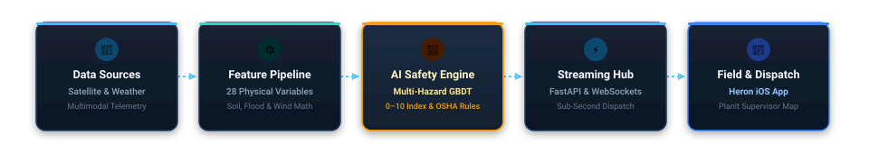

<p align="center">
  
</p>

<h1 align="center">Heron</h1>
<p align="center">
  <b>Real-Time Environmental Intelligence & Worker Safety Platform for Florida Utility Field Crews</b>
</p>

---

## 🎯 Executive Summary

### The Problem
Electric utility linemen, power plant operators, and field service crews work in high-risk outdoor environments where weather shifts within minutes. In Florida, lightning, dangerous heat index spikes ($>105^\circ\text{F}$), and flash flooding at low-lying substations cause life-threatening risks. Consumer weather apps only report city-wide forecasts hours late with no site-specific geotechnical awareness and no enforcement of **OSHA stop-work safety mandates**.

### The Solution
**Heron** is an environmental intelligence and worker safety platform monitoring **346 EIA-860M Florida electric power generation and substation sites** across all 67 Florida counties. 

Heron fuses high-frequency telemetry from orbital weather satellites, ground meteorological networks, and geotechnical hydrological models into a calibrated **Multi-Hazard Machine Learning Model**. The system computes a continuous **0–10 Hazard Index** for every facility in Florida and streams instantaneous, life-saving stop-work directives directly to field crews' iPhones via native SwiftUI and WebSockets.

---

## 🏗 High-Level Architecture

<p align="center">
  
</p>

---

## ⚡ Core Capabilities

- **346 Monitored Energy Plants**: Official EIA-860M Florida registry (from Turkey Point Nuclear to municipal solar yards and battery storage).
- **Sub-Second Satellite Lightning Detection**: Ingests real-time lightning flashes from NOAA's **GOES-19 Geostationary Lightning Mapper (GLM)** stationed 22,236 miles in orbit.
- **Calibrated 0–10 Hazard Index**: Combines gradient-boosted multi-hazard classification with physical plausibility gates to eliminate false alarms while guaranteeing safety.
- **Physical Soil Saturation**: Uses ECMWF ERA5-Land physical soil water content weighted across 3 distinct sub-surface root layers against a $0.45\text{ m}^3/\text{m}^3$ porosity threshold.
- **Deterministic OSHA Safety Mandates**:
  - ⚡ **10-Mile Lightning Rule**: Work stops immediately when a strike occurs within 10 miles. Starts an automated 30-minute all-clear timer that resets on subsequent strikes.
  - 🔥 **Extreme Heat Protocol**: Mandatory 15-min rest at $\ge 105^\circ\text{F}$; full work stoppage at $\ge 115^\circ\text{F}$.
  - 🌊 **FEMA 100-Year Inundation**: $\ge 25\text{ mm}$ rain inside a regulatory floodway triggers a site Flood Warning.
- **Field Crew Hazard Reporting**: Linemen can capture hazard photos, automatically attach verified GPS coordinates, and sync reports with dispatch in real time.

---

## 📖 In-Depth Technical Documentation

For deep technical details, model evaluation benchmarks, and architectural designs, explore our specialized sub-module documentation:

| Sub-Module | Focus & Technical Depth | Documentation Link |
| :--- | :--- | :---: |
| 🧠 **Machine Learning & Pipeline** | Multi-hazard GBDT vs. PyTorch vs. Random Forest benchmarks (94.5% test accuracy), 28-feature schema, evaluation ROC/confusion matrix plots, and continuous learning hot-swap loop. | [**Machine Learning Guide**](backend/pipeline/README.md) |
| ⚙️ **Backend & Streaming Engine** | FastAPI 0.115 architecture, async satellite pollers, message bus, sequence-buffered WebSockets, and scripted simulation CLI. | [**Backend Architecture**](backend/README.md) |
| 📱 **Native iOS App ("Heron")** | Native SwiftUI (iOS 17+), high-glare Marsh design tokens, MapKit supervisor view, time-sensitive local notifications, and camera integration. | [**iOS App Guide**](frontend/README.md) |

---

## 🚀 Quickstart & Live Judging Demo Guide

Run the complete Heron stack locally in under 2 minutes:

### 1. Start the Backend Server

```bash
# Navigate to the backend directory
cd backend

# Create and activate Python virtual environment
python3 -m venv .venv
source .venv/bin/activate

# Install production dependencies
pip install -r requirements.txt

# Start the FastAPI engine (binds to 0.0.0.0:8000 for local network device access)
uvicorn crewsafe.api.main:app --host 0.0.0.0 --port 8000
```
- **Interactive Swagger API Documentation**: [http://localhost:8000/docs](http://localhost:8000/docs)
- **Health Check Endpoint**: [http://localhost:8000/api/v1/health](http://localhost:8000/api/v1/health)

*(The backend seeds all 346 EIA power facilities from `backend/pipeline/data/incidents.db` and begins telemetry ingestion).*

---

### 2. Launch the Native iOS App

```bash
# In a new terminal, navigate to the iOS project directory
cd frontend/ios

# Generate the Xcode project cleanly using XcodeGen
xcodegen generate

# Open the project in Xcode
open CrewSafe.xcodeproj
```
- Select an **iPhone 17 Simulator** (or your plugged-in physical iPhone).
- Press **<kbd>Cmd</kbd> + <kbd>R</kbd>** to build and run.

---

### 3. Simulate Emergency Events in Real-Time

Heron includes a command-line simulation tool ([`backend/crewsafe/prompt.py`](backend/crewsafe/prompt.py)) that injects simulated events into the running pipeline, demonstrating how the system responds to real-time emergencies:

In a separate terminal window:

```bash
# ⚡ Simulate a lightning strike 4 miles from John R Kelly Plant (Site 664):
backend/.venv/bin/python -m crewsafe.prompt "lightning 4 miles from 664"
# --> Initiates an immediate Stop-Work Hold, broadcasts to iOS, and starts the 30-min countdown.

# 🌊 Simulate an extreme flood warning & heavy rain:
backend/.venv/bin/python -m crewsafe.prompt "flood at 664"
# --> Injects 3.5 inches of rain into the model, spikes the Hazard Index, and issues a Flood Warning.

# 📋 Simulate tomorrow's 6 PM Safety Briefing:
backend/.venv/bin/python -m crewsafe.prompt briefing
# --> Pushes an immediate time-sensitive notification with tomorrow's hazard outlook.

# ☀️ Clear active lightning holds:
backend/.venv/bin/python -m crewsafe.prompt "clear at 664"

# 💻 Launch the interactive simulation shell:
backend/.venv/bin/python -m crewsafe.prompt
```

---

### 4. Run the Automated Test Suite

```bash
backend/.venv/bin/pytest -q backend/tests
```
*(All 28 contract, pipeline, WebSocket, and simulation tests pass).*

---

## 📂 Repository Organization

```
heron-planit-control/
├── backend/                        # Comprehensive Backend & ML Pipeline Tier
│   ├── crewsafe/                   # Production Real-Time Engine (FastAPI 0.115)
│   │   ├── api/                    # REST routes, auth, WebSocket hub (/ws/updates)
│   │   ├── contracts/              # Strict Pydantic contracts mirroring Swift models
│   │   ├── ingestion/              # Real-time pollers: Open-Meteo, NWS, GOES-19 GLM
│   │   ├── messaging/              # At-least-once message bus (in-memory / Kafka)
│   │   ├── processing/             # Features, transformer, scoring engine, alerts
│   │   ├── storage/                # Repository interface, in-memory state, SQLite
│   │   └── prompt.py               # Natural-language CLI for live judging simulations
│   │
│   ├── pipeline/                   # Data Science, ML Modeling & Retraining Pipeline
│   │   ├── data/                   # 47,150 historical records (OSHA, NOAA, NIFC, FEMA)
│   │   ├── model/                  # Multi-hazard GBDT, PyTorch models, and benchmark artifacts
│   │   └── steps/                  # ETL extraction and transformation scripts
│   │
│   ├── tests/                      # Automated test suite (28 passing pytest tests)
│   └── requirements.txt            # Python dependencies
│
└── frontend/                       # Native iOS Client Application ("Heron")
    └── ios/
        ├── CrewSafe/               # Native Swift source code (iOS 17+)
        └── project.yml             # Declarative XcodeGen project specification
```

---

*Built with ❤️ at SwampHacks 2026 by Saaketh & Sai.*